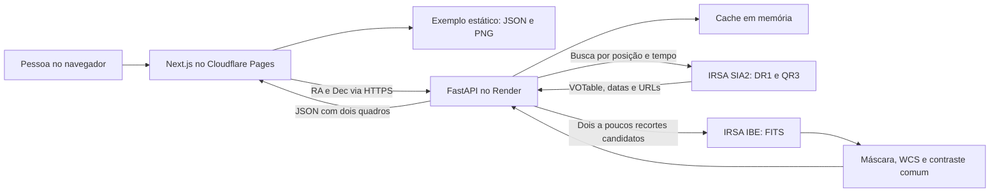

# Planet X and SPHEREx — plano de entrega em 36 horas

**Entrega.** Um site público com uma página inicial e um explorador. A pessoa informa ascensão reta e declinação, vê dois recortes reais do mesmo campo em épocas distintas e alterna entre eles para procurar movimento ou variação de brilho. A página também oferece um exemplo pré-processado que funciona quando a API está indisponível.

**Configuração escolhida.** Next.js com TypeScript no Cloudflare Pages e FastAPI com Python 3.12 no Render. Um repositório público no GitHub, dois deploys, imagens SPHEREx DR1 e QR3 no NASA/IPAC IRSA, cache em memória e exemplos estáticos com procedência. Custo inicial de **US$ 0**. O plano assume pelo menos uma pessoa com experiência em React, duas capazes de depurar Python e uma responsável pelos deploys. O acesso ao IRSA a partir do Render e a seleção de imagens comparáveis são os primeiros riscos a verificar.

## Comecem por aqui

No início, combinem quem assume cada papel e registrem a hora de início. **H0** é o início do trabalho e **H4** é quatro horas depois. P5 compartilha o link do repositório e acompanha os marcos do cronograma. Cada pessoa já pode começar pela tarefa abaixo.

| Papel | Primeira ação | Resultado esperado até H4 |
|---|---|---|
| **P1 · Landing** | Criar `/` com uma descrição do desafio e um botão para `/explorar`. | Navegação funcionando no celular e no computador. |
| **P2 · Explorador** | Combinar o formato do JSON com P3 e ligar o visor a dois PNGs de teste. | O visitante consegue carregar o exemplo e alternar entre os quadros. |
| **P3 · API e IRSA** | Criar `GET /health`, preparar a resposta de teste e executar a consulta de M101 no fim deste documento. | O frontend publicado lê o JSON de teste e P4 recebe dois recortes FITS de épocas distintas ou a evidência da falha. |
| **P4 · Dados** | Abrir os FITS de P3, conferir detector e faixa espectral e alinhar os recortes. | Dois PNGs comparáveis com manifesto de origem, ou o motivo técnico pelo qual o par precisa ser substituído. |
| **P5 · Publicação e testes** | Criar o repositório e publicar o esqueleto das duas aplicações gratuitas. | URLs da landing e da API compartilhadas com a equipe, com CORS e acesso ao IRSA do Render conferidos. |

Para o repasse inicial dos dados, P3 entrega a P4 os URLs dos produtos e dos recortes, identificadores, datas de observação e os FITS. P4 entrega a P2 e P5 os dois PNGs e o manifesto. P5 abre a versão publicada e verifica que os arquivos aparecem na ordem correta, com datas e fonte.

## 1. Escopo e stack

| Camada                 | Escolha                                       | O que a equipe entrega                                                                                                                                                                                  |
| ---------------------- | --------------------------------------------- | ------------------------------------------------------------------------------------------------------------------------------------------------------------------------------------------------------- |
| Página inicial `/`     | Next.js App Router, TypeScript e CSS          | Explicação curta do desafio, um recorte real da demo, créditos e botão **Explorar o céu**.                                                                                                              |
| Explorador `/explorar` | React no mesmo Next.js, exportação estática   | Formulário RA/Dec em graus ICRS, preset de um alvo confirmado, alternância manual e reprodução automática, datas UTC, comprimento de onda, origem e estados de carregamento, ausência de dados e falha. |
| API                    | FastAPI, Pydantic, Uvicorn e Requests         | Validação de coordenadas, busca e download no IRSA, resposta JSON documentada em OpenAPI e `GET /health`.                                                                                               |
| Processamento          | Astropy, reproject, NumPy e Pillow            | Leitura de VOTable/FITS, seleção dos quadros, máscara, reprojeção, contraste compartilhado e exportação de PNG.                                                                                         |
| Dados do MVP           | JSON e PNG versionados, cache limitado em RAM | O exemplo abre direto do frontend. A API guarda resultados pequenos por tempo limitado.                                                                                                                 |

O campo de visão é fixo em **6′ × 6′**. Para ganhar tempo, a primeira versão exibe **dois quadros**, usa um único grupo espectral comparável por comparação e aceita graus decimais. A landing e o explorador compartilham layout e estilos. Filtros livres, campo de visão variável, sobreposições Gaia/WISE, subtração, espectros e detecção automática ficam para depois da demo. A experiência principal cabe em uma tela e deve funcionar no celular e com teclado. [Enunciado](https://www.spaceappschallenge.org/2026/challenges/planet-x-and-spherex/?tab=details) · [Export estático do Next.js](https://nextjs.org/docs/app/guides/static-exports)

## 2. Arquitetura e integração



### Fontes e limites

| Fonte | Formato e acesso | Limites documentados |
|---|---|---|
| Imagens espectrais DR1 e QR3 Wide Survey | GET público no SIA2, com `COLLECTION=spherex_dr1` ou `spherex_qr3`, `POS` em graus ICRS e `TIME` em MJD quando necessário. O retorno padrão é VOTable. Usar `access_url`, `obs_publisher_did` ou `obs_id`, `t_min` e `t_max`, e metadados espectrais. | `MAXREC` limita o retorno. O padrão é sem limite de linhas e o serviço cancela consultas que passam de 5 minutos. Novos dados são ingeridos semanalmente, com defasagem de aproximadamente um dia no SIA. A documentação consultada não publica cota de requisições por minuto. [SIA2 e limites](https://irsa.ipac.caltech.edu/ibe/sia.html#MAXREC) · [Dados disponíveis e ingestão](https://caltech-ipac.github.io/irsa-tutorials/spherex-intro/) |
| Recortes IBE das exposições selecionadas | GET no `access_url` HTTPS do IRSA com `center=RA,Dec&size=0.1`. A largura completa é 0,1 grau. O retorno é FITS multiextensão, com gzip por padrão. | O IBE documenta unidades e HTTP 400 para parâmetros inválidos. A documentação consultada não publica cota numérica, limite de concorrência ou SLA para recortes. [API de recortes](https://irsa.ipac.caltech.edu/ibe/cutouts.html) · [Exemplo oficial](https://caltech-ipac.github.io/spherex-archive-documentation/spherex-data-access/#cutouts-of-spherex-spectral-image-mefs) |

DR1 inclui os Surveys 1 e 2 reprocessados. QR3 acrescenta observações posteriores com processamento compatível. A sequência usa exposições individuais porque o cubo de todo o céu agrega observações. O IRSA pede a citação **10.26131/IRSA678** para as imagens DR1 e **10.26131/IRSA662** para QR3, junto com o reconhecimento indicado em suas páginas. Colocar os créditos no site, no README e na entrega do hackathon. [DR1](https://irsa.ipac.caltech.edu/data/SPHEREx/docs/overview_dr1.html) · [QR3](https://irsa.ipac.caltech.edu/data/SPHEREx/docs/overview_qr.html) · [Termos de uso do IRSA](https://irsa.ipac.caltech.edu/data_use_terms.html)

As três referências originais foram lidas, incluindo a aba **Details** no navegador. A aba **Resources** também lista WiseView, Gaia DR3 e recursos canadenses. O link do WiseView retornou 502 na checagem. O SIA não retornou uma resposta verificável no ambiente desta proposta. A cobertura dos alvos, o tempo de resposta e o uso de RAM ainda precisam ser medidos pela equipe. [Recursos oficiais do desafio](https://www.spaceappschallenge.org/2026/challenges/planet-x-and-spherex/?tab=resources) · [Portal do SPHEREx no IRSA](https://irsa.ipac.caltech.edu/Missions/spherex.html) · [Tutoriais oficiais](https://caltech-ipac.github.io/irsa-tutorials/spherex/)

### Regras de processamento

1. Consultar as duas coleções. Validar posição e cobertura. Deduplicar pelo identificador do produto, agrupar exposições por visita ou época de observação e priorizar pares separados por meses. Ordenar pela data da exposição. Se o resultado vier truncado, consultar janelas de tempo menores dentro do tempo disponível e registrar a limitação.
2. Baixar apenas recortes do domínio oficial retornados pela consulta. Começar com orçamento de **até 8 candidatos, downloads em série por busca e 45 s para o processamento de uma busca com o serviço já ativo**. Limitar concorrência no servidor e tamanho dos downloads. Respeitar `Retry-After` em HTTP 429 dentro do orçamento, quando aplicável. Esses números são limites do app para validar no host.
3. Ler `IMAGE` e `FLAGS`, conferir cobertura e mascarar pixels inválidos com os bits documentados. Calcular comprimento de onda e largura de banda no centro com o WCS espectral. Priorizar mesmo detector e passagens sobrepostas. Se não houver dois quadros adequados, retornar cobertura insuficiente.
4. Reprojetar as duas exposições na mesma grade celeste, com norte para cima e orientação consistente. Aplicar um único intervalo de contraste calculado sobre os pixels válidos dos dois quadros e preservar a mesma marcação de bordas sem dados. Verificar visualmente se as estrelas de referência continuam alinhadas. [Notebook de imagens, WCS e flags](https://caltech-ipac.github.io/irsa-tutorials/spherex-intro/) · [Notebook de recortes](https://caltech-ipac.github.io/irsa-tutorials/spherex-cutouts/) · [Reprojeção](https://docs.astropy.org/projects/reproject/en/stable/celestial.html)

## 3. Contrato, arquivos e cache

Começar com `GET /health` e `GET /api/v1/sequence?ra_deg=210.80227&dec_deg=54.34895`. A API valida `0 ≤ RA < 360` e `−90 ≤ Dec ≤ 90`, com valores finitos. Definir o modelo Pydantic e uma resposta de exemplo antes de implementar FITS. O frontend deve conseguir trocar o exemplo pela API por meio de uma configuração de URL.

| Campo da sequência | Conteúdo |
|---|---|
| `sequence_id` | Identificador da sequência. |
| `ra_deg`, `dec_deg`, `fov_arcmin` | Centro em ICRS e lado do recorte. |
| `collections`, `fetched_at_utc`, `generated_at_utc`, `processing_version` | Coleções consultadas, horário real de obtenção, horário de geração e versão da transformação. |
| `frames` | Dois quadros em ordem cronológica. Cada um traz `frame_id`, `observed_at_utc`, `collection`, `detector`, `wavelength_um`, `bandwidth_um`, `calibration_version`, `source_url`, `cutout_url`, `valid_fraction` e `image_src`. |

Para o MVP, `image_src` pode ser um **PNG pequeno em data URL** na resposta ao vivo e um caminho para PNG local no exemplo estático. Isso mantém a comparação em uma única chamada e evita criar uma rota para servir arquivos temporários. Medir o tamanho do JSON no teste publicado e adotar um teto inicial de 500 KiB por resposta. Exibir os horários de observação no visor e a data de recuperação nos detalhes da fonte. [Modelos de resposta do FastAPI](https://fastapi.tiangolo.com/tutorial/response-model/)

| Resposta | Comportamento no explorador |
|---|---|
| `200` | Apresentar os dois quadros, data, detector, comprimento de onda e link da fonte. |
| `422` | Indicar qual coordenada precisa ser corrigida. |
| `404` com `insufficient_coverage` | Explicar que o campo consultado tem menos de dois quadros comparáveis e oferecer um alvo de exemplo. |
| `503` ou `504` | Informar indisponibilidade ou demora na consulta e oferecer **Abrir exemplo**. Tratar também falha de rede e resposta não JSON durante a inicialização do host. |

```text
frontend/                     Next.js e dependências Node
  app/page.tsx                landing
  app/explorar/page.tsx        explorador
  public/examples/<alvo>/     manifest.json + dois PNGs reais
backend/                     FastAPI e requirements.txt
  app/main.py                 rotas e CORS
  app/irsa.py                 consulta SIA2 e recortes IBE
  app/processing.py           seleção, WCS e renderização
```

O arquivo de exemplo usa os mesmos campos da resposta publicada. Guardar em RAM apenas os resultados finais, com chave por coordenadas normalizadas, campo, coleções e versão do processamento. Ponto de partida para o cache: **até 32 entradas, TTL de 24 h e descarte dos FITS após uso**. O cache pode desaparecer no reinício. Os PNGs e o manifesto de exemplo são persistidos no GitHub e publicados pelo Pages. O conteúdo sintético usado para desenvolver a interface fica fora da demo final.

## 4. Deploy e orçamento

| Serviço | Configuração | Limites e cobrança |
|---|---|---|
| **Cloudflare Pages Free** | Projeto GitHub na branch `main`, diretório raiz `frontend`, build estático do Next.js e saída `out`. Configurar `NEXT_PUBLIC_API_BASE_URL` no build. Usar o subdomínio `pages.dev`. | Sem cartão no cadastro anunciado. **500 builds/mês**, um build por vez, timeout de 20 min, até 20 mil arquivos e 25 MiB por arquivo. Requisições a arquivos estáticos são gratuitas. A configuração do MVP usa hospedagem estática. [Deploy](https://developers.cloudflare.com/pages/framework-guides/nextjs/deploy-a-static-nextjs-site/) · [Monorepo](https://developers.cloudflare.com/pages/configuration/monorepos/) · [Limites](https://developers.cloudflare.com/pages/platform/limits/) · [Plano e cadastro](https://www.cloudflare.com/products/pages/) |
| **Render Hobby + Free Web Service** | Projeto GitHub na branch `main`, raiz `backend`, runtime Python, build `pip install -r requirements.txt` e start `uvicorn app.main:app --host 0.0.0.0 --port $PORT`. Fixar a versão Python usada localmente e permitir no CORS os endereços exatos do frontend publicado e do localhost. | **512 MB RAM**, **750 h mensais de instância**, **5 GB mensais de tráfego de saída** e **500 min mensais de build**. Tem **um membro** por workspace. Dorme após **15 min sem tráfego** e pode levar cerca de **1 min** para voltar. Disco efêmero. Sem meio de pagamento, exceder tráfego suspende serviços gratuitos e exceder minutos paralisa novos builds até o próximo mês. Com pagamento vinculado, excedentes podem ser cobrados. O Render também pode suspender serviços gratuitos por volume incomum de chamadas externas. [FastAPI no Render](https://render.com/docs/deploy-fastapi) · [Versão de Python](https://render.com/docs/python-version) · [Hobby](https://render.com/docs/new-workspace-plans#hobby) · [Limites Free](https://render.com/docs/free) · [RAM e preços](https://render.com/pricing) · [CORS](https://fastapi.tiangolo.com/tutorial/cors/) |
| **GitHub Free** | Repositório público para os cinco integrantes. Dependências e exemplos pequenos no Git. Uma pessoa controla o Render e disponibiliza os logs relevantes à equipe. | Conta gratuita com e-mail verificado e sem cartão no fluxo documentado. Arquivos acima de 50 MiB geram aviso e acima de 100 MiB são bloqueados no Git comum. Produtos pagos e excedentes em serviços medidos podem gerar despesas quando habilitados. [Cadastro](https://docs.github.com/en/account-and-profile/how-tos/account-management/creating-an-account-on-github) · [Planos](https://docs.github.com/en/get-started/learning-about-github/githubs-plans) · [Limites de arquivo](https://docs.github.com/en/repositories/working-with-files/managing-large-files/about-large-files-on-github) · [Cobrança do Git LFS](https://docs.github.com/en/billing/concepts/product-billing/git-lfs) |

P5 testa a URL pública em janela anônima. Antes da apresentação, abrir `/health` e aguardar HTTP 200 antes da busca ao vivo. Na interface, mostrar carregamento e manter o exemplo acessível enquanto a API inicia. Medir uma busca fria, uma consulta com serviço ativo e uma repetição em cache. Conferir o consumo de memória com dois visitantes consultando ao mesmo tempo e limitar a execução simultânea conforme o teste.

## 5. Responsáveis, dependências e cronograma

| Pessoa | Responsabilidade | Entrega verificável |
|---|---|---|
| **P1 · Landing** | Página inicial, linguagem, identidade e layout responsivo | CTA leva ao explorador e a página abre bem em largura de celular. |
| **P2 · Explorador** | Formulário, teclado, alternância, play/pause, estado de busca e integração com a API | A mesma tela reproduz uma sequência de exemplo e outra retornada pela API. |
| **P3 · API e IRSA** | OpenAPI, CORS, busca por posição e tempo, download, erros e cache | Endpoint responde com o formato acordado e registra tempo de consulta e resultado sem armazenar FITS em disco persistente. |
| **P4 · Dados** | Critério de seleção, FITS, WCS, contraste e validação visual | Dois PNGs comparáveis, manifesto completo e evidência de alinhamento. |
| **P5 · Publicação e testes** | Deploy, integração pública, matriz dos alvos, roteiro e submissão | Ambas as URLs publicadas, teste anônimo e demo ensaiada. |

| Horas corridas | Trabalho em paralelo | Marco e dependência |
|---|---|---|
| **H0–H1** | P2 e P3 combinam o JSON da API. P1 define o fluxo da landing. P3 e P4 começam a consulta de prova. P5 configura repositório e serviços gratuitos. | Contrato suficiente para P2 avançar com exemplo local. |
| **H1–H4** | P1 e P2 montam páginas com fixture. P3 recupera dois FITS. P4 abre, verifica a faixa e alinha. P5 publica o esqueleto com `/health`, testa CORS e confere acesso ao IRSA do Render. | Até H4, JSON de exemplo no navegador publicado e dois recortes reais recuperados com origem rastreável. |
| **H4–H10** | P1 finaliza landing. P2 fecha reprodução e estados. P3 implementa busca e cache. P4 empacota o primeiro exemplo real. P5 valida coordenadas e começa a matriz dos cinco alvos com P4. | O exemplo real funciona no site e a equipe registra qual alvo tem sinal visual para a demo. |
| **H10–H16** | P2, P3 e P4 integram a busca ao vivo. P1 testa a experiência no celular. P5 publica e repete a consulta em janela anônima. | Coordenadas → IRSA → dois quadros no site publicado. |
| **H16–H23** | Pausas escalonadas. P3 e P5 medem latência, cache e memória. P2 corrige erros de integração. P1 e P4 revisam apresentação, alinhamento e créditos. P4 e P5 fecham a matriz. | Testes do fluxo principal, entradas inválidas, cobertura insuficiente e exemplo com API indisponível. |
| **H23–H29** | P5 publica a versão candidata. Todos ensaiam uma vez com consulta ao vivo e uma vez com exemplo, e corrigem somente bloqueios. | URL final e apresentação prontas até H29. |
| **H29–H34** | Margem de cinco horas para falha de build, latência, troca de alvo ou correção de integração. | Versão estável para a entrega. |
| **H34–H36** | Apresentação ou submissão. | URL pública, créditos e demonstração acessíveis. |

**Se a seleção automática atrasar em H4**, P3 e P4 fixam um detector e um critério de compatibilidade espectral validados no campo de prova. Até H10, P2 e P5 publicam o primeiro par real com datas e reprodução. Até H16, P3 conecta a busca por coordenadas à seleção restrita. Até H23, P4 e P5 registram a cobertura para os cinco alvos. Se a consulta ao vivo falhar após a margem, manter o exemplo real público e registrar na entrega que a busca dinâmica ficou pendente.

**Se nenhum par real estiver disponível em H4**, P3 testa a consulta a partir da máquina local e do Render para localizar a falha. Em paralelo, P4 tenta selecionar e baixar duas exposições compatíveis pelo Data Explorer ou testa outro alvo. P1, P2 e P5 seguem com o desenvolvimento e a publicação das telas. Se a equipe ainda não tiver imagens reais na entrega, apresenta o visor como protótipo com dados de teste identificados e registra a validação científica como pendente. [Busca no Data Explorer](https://irsa.ipac.caltech.edu/onlinehelp/spherex/spherex/searching.html) · [Download no Data Explorer](https://irsa.ipac.caltech.edu/onlinehelp/spherex/spherex/downloads.html)

**Matriz dos alvos.** Testar Estrela de Barnard, Epsilon Indi B, WISE 0855, RW Aurigae e R Draconis. Em cada caso, registrar origem das coordenadas, épocas, detector, faixa, cobertura e resultado visual. Para os alvos de movimento, comparar com estrelas fixas do campo. Para as duas variáveis, procurar mudança de brilho com contraste comum. Marcar explicitamente resultados inconclusivos. O primeiro exemplo para a demo deve ser o alvo com deslocamento mais claro. [Alvos do desafio](https://www.spaceappschallenge.org/2026/challenges/planet-x-and-spherex/?tab=details) · [Busca por nome ou coordenadas no IRSA](https://irsa.ipac.caltech.edu/onlinehelp/spherex/spherex/searching.html)

| Alvo | O que observar | Situação inicial |
|---|---|---|
| Estrela de Barnard | Deslocamento entre épocas | A testar |
| Epsilon Indi B | Deslocamento da fonte no campo | A testar |
| WISE 0855 | Deslocamento entre épocas | A testar |
| RW Aurigae | Variação de brilho | A testar |
| R Draconis | Variação de brilho | A testar |

**Roteiro de 90 segundos.** P5 abre a landing, entra no explorador e carrega o melhor alvo. P4 mostra as datas, alterna os quadros e indica o objeto em relação às estrelas de referência. P5 abre os detalhes da fonte e mostra onde pesquisar outro campo. Se a busca estiver indisponível, abrir o exemplo identificado como pré-processado.

### Checklist de entrega

- [ ] A landing e `/explorar` abrem em janela anônima e o link direto para `/explorar` funciona ao recarregar.
- [ ] Uma consulta por RA/Dec feita no site publicado retorna dois quadros reais, com a mesma orientação e datas de observação distintas. O controle de pausa e a alternância manual funcionam.
- [ ] O visor informa coordenada inválida, cobertura insuficiente e falha de rede. O exemplo real continua acessível com a API indisponível.
- [ ] A matriz contém o resultado dos cinco alvos. O exemplo da demo tem procedência, atribuição e evidência visual registrada.
- [ ] O README aponta para a URL pública e explica como rodar os dois serviços localmente. A submissão inclui a URL do app e os créditos ao IRSA.

## 6. Estudo por papel

Os tempos indicam estudo e um exercício curto. Os blocos **durante** já estão incluídos no cronograma. Se o evento já começou, priorizar os exercícios do bloco H0–H4 e usar as referências conforme aparecem dúvidas.

| Ordem | Quem e tempo | Aprender e pôr em prática |
|---|---|---|
| **Antes 1** | Todos, 20–30 min | Revisar Git/GitHub, clonar, criar branch e abrir um PR. P3 e P4 montam um ambiente Python 3.12. [GitHub Hello World](https://docs.github.com/en/get-started/using-github/hello-world) · [Python `venv`](https://docs.python.org/3/tutorial/venv.html) |
| **Antes 2** | P1 e P2, 45 min | Criar duas rotas com App Router, declarar o tipo da resposta em TypeScript e gerar `out` localmente. [Instalação do Next.js](https://nextjs.org/docs/app/getting-started/installation) · [Páginas e layouts](https://nextjs.org/docs/app/getting-started/layouts-and-pages) · [Tipos de objeto](https://www.typescriptlang.org/docs/handbook/2/objects.html) · [Export estático](https://nextjs.org/docs/app/guides/static-exports) |
| **Antes 3** | P3, P4 e P5, 30 min | Ler desafio, releases e tutoriais. Preparar a lista dos cinco alvos e responsabilidades. [Detalhes](https://www.spaceappschallenge.org/2026/challenges/planet-x-and-spherex/?tab=details) · [Releases](https://caltech-ipac.github.io/spherex-archive-documentation/spherex-data-releases/) |
| **Durante H0–H2** | P3, 60 min | Definir respostas do FastAPI, fazer a primeira consulta SIA2, abrir VOTable e baixar um recorte IBE. [FastAPI](https://fastapi.tiangolo.com/tutorial/first-steps/) · [Requests e timeouts](https://requests.readthedocs.io/en/latest/user/quickstart/#timeouts) · [SIA2](https://irsa.ipac.caltech.edu/ibe/sia.html) · [VOTable](https://docs.astropy.org/en/stable/io/votable/) · [IBE](https://irsa.ipac.caltech.edu/ibe/cutouts.html) |
| **Durante H0–H4** | P4, 90 min | Ler FITS, flags, datas e WCS. Reprojetar dois quadros e exportar PNGs com escala comum. [Notebook de recortes](https://caltech-ipac.github.io/irsa-tutorials/spherex-cutouts/) · [Astropy FITS](https://docs.astropy.org/en/stable/io/fits/) · [Datas em Astropy](https://docs.astropy.org/en/stable/time/index.html) · [reproject](https://docs.astropy.org/projects/reproject/en/stable/celestial.html) · [NumPy percentis](https://numpy.org/doc/stable/reference/generated/numpy.nanpercentile.html) · [Pillow PNG](https://pillow.readthedocs.io/en/stable/handbook/image-file-formats.html#png) |
| **Durante H0–H4** | P5, 45–60 min | Publicar as duas aplicações, testar CORS e olhar os logs. [Next.js no Pages](https://developers.cloudflare.com/pages/framework-guides/nextjs/deploy-a-static-nextjs-site/) · [FastAPI no Render](https://render.com/docs/deploy-fastapi) · [CORS no FastAPI](https://fastapi.tiangolo.com/tutorial/cors/) |
| **Durante H1–H6** | P1 e P2, 30–45 min | Montar o formulário e capturar a resposta de exemplo pelo navegador. Implementar play/pause e conferência por teclado. [Componentes de cliente e servidor no Next.js](https://nextjs.org/docs/app/getting-started/server-and-client-components) · [Estado no React](https://react.dev/learn/state-a-components-memory) |
| **Durante H4–H10** | P4 e P5, 30 min | Conferir resultados no Data Explorer e preencher a matriz de validação. [Busca do IRSA](https://irsa.ipac.caltech.edu/onlinehelp/spherex/spherex/searching.html) · [Alinhamento no Data Explorer](https://irsa.ipac.caltech.edu/onlinehelp/spherex/spherex/visualization.html) |
| **Depois** | P3 e P4, 2 h | Experimentar cubos, PSF e extração de espectros. Só depois disso estimar o custo de ampliar as opções de comparação. [Tutoriais oficiais](https://caltech-ipac.github.io/irsa-tutorials/spherex/) |

## Primeira tarefa da equipe

**P3 e P4 começam com M101 (`210.80227°, +54.34895°`)** e em seguida tentam Barnard ou WISE 0855 para encontrar o alvo da demo. Esta consulta é um teste inicial de metadados e serve para cada coleção. Aumentar `MAXREC` ou usar janelas `TIME` para procurar épocas separadas, pois os primeiros cinco resultados podem pertencer à mesma visita.

```sh
curl -fsS --max-time 20 -G 'https://irsa.ipac.caltech.edu/SIA' \
  --data-urlencode 'COLLECTION=spherex_dr1' \
  --data-urlencode 'POS=circle 210.80227 54.34895 0.01' \
  --data-urlencode 'MAXREC=5' \
  --data-urlencode 'RESPONSEFORMAT=VOTABLE' \
  -o m101-dr1.xml
```

**Validação concluída até H4** quando a equipe consegue rastrear dois produtos de épocas distintas da VOTable às URLs oficiais, baixar dois FITS válidos, comprovar compatibilidade espectral e gerar dois PNGs do mesmo campo em uma grade alinhada. O manifesto registra as datas de observação, detector, comprimento de onda e procedência. Em paralelo, P5 confirma que o Render alcança o IRSA a partir do serviço publicado. O teste de M101 confirma a integração e o teste do alvo do desafio confirma a utilidade visual para a demo. [Coordenadas e recortes de M101 no IRSA](https://caltech-ipac.github.io/irsa-tutorials/spherex-cutouts/)


Ajustar.