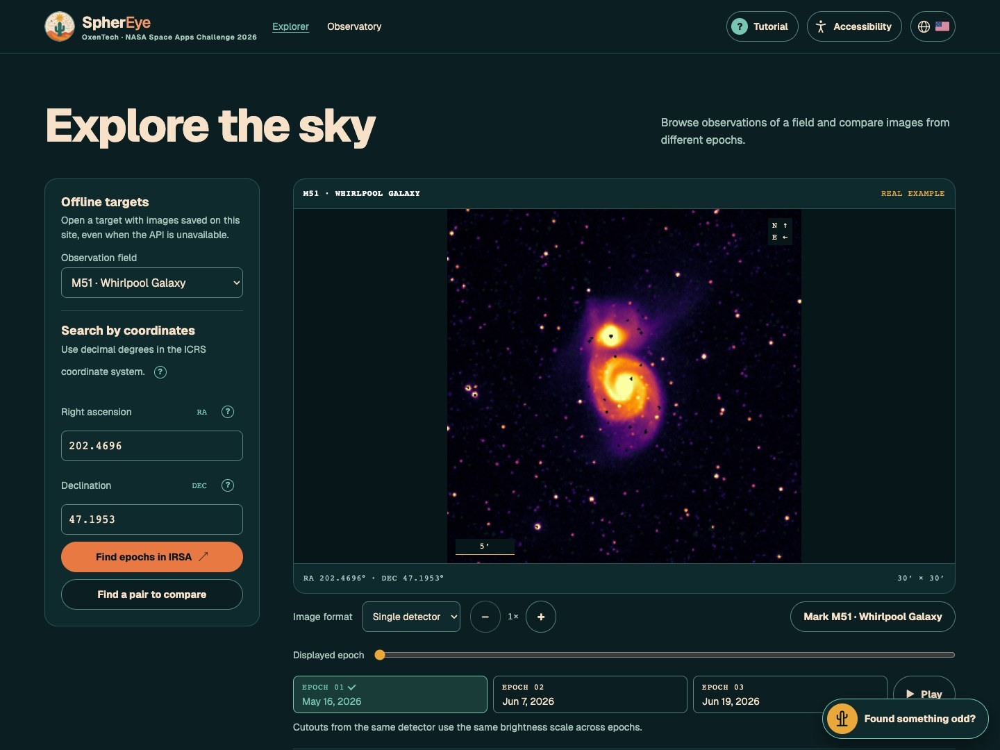
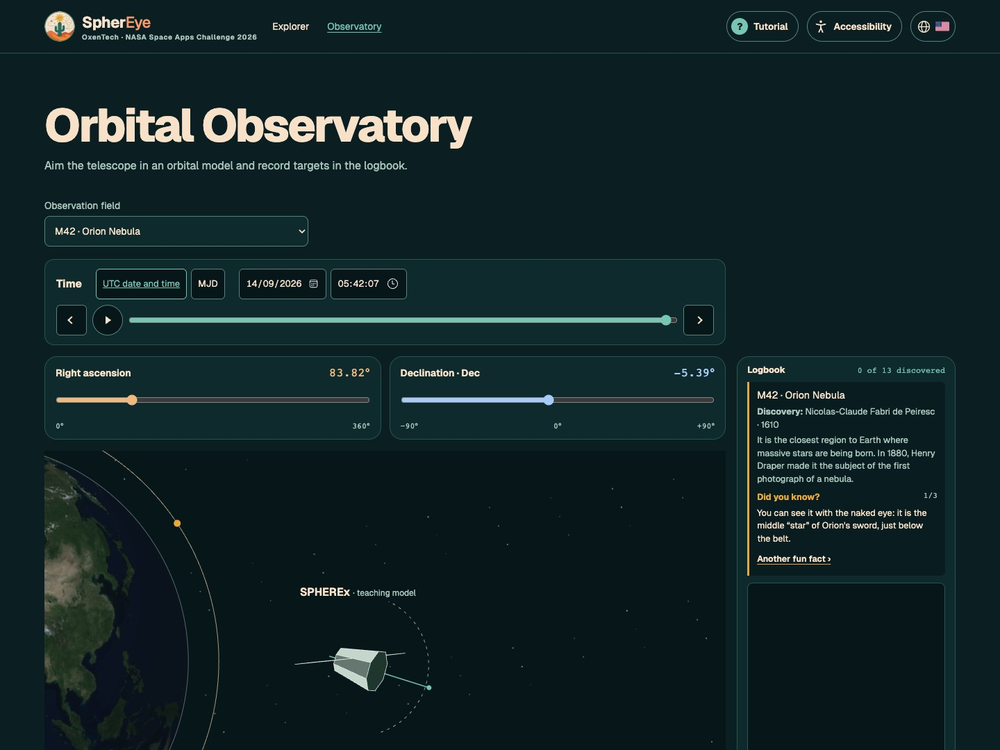

# SPHEREye

O SPHEREye é um aplicativo educacional da equipe **OxenTech** para o NASA Space Apps Challenge 2026. A experiência parte das fotografias que levaram à descoberta de Plutão e propõe a mesma pergunta com imagens do telescópio infravermelho SPHEREx: o que mudou no céu entre duas observações?

[**Abra o SPHEREye**](https://sphereye.earth/) · [**Acesse em português**](https://sphereye.earth/pt/) · [Desafio Planet X and SPHEREx](https://www.spaceappschallenge.org/2026/challenges/planet-x-and-spherex/?tab=details)


## Experimente em três passos

1. No [Explorador](https://sphereye.earth/explore/), a galáxia **M51** abre por padrão. Selecione duas épocas e alterne entre elas. Use o zoom e o marcador para inspecionar a mesma região das imagens. O contexto do alvo e as curiosidades acompanham os exemplos salvos.
2. No [Observatório orbital](https://sphereye.earth/observatory/), ajuste a ascensão reta e a declinação e controle o tempo da simulação. Ao encontrar um alvo, a ficha abre automaticamente com seus dados e curiosidades. Use o diário de bordo para rever a ficha ou importe as coordenadas para o Explorador.
3. No [Laboratório de apontamento](https://sphereye.earth/lab/), arraste o globo ou edite os valores de RA e Dec para entender como as duas coordenadas orientam a linha de visão. Importe o ponto escolhido para buscar observações no Explorador.

### Explorador de imagens

Os presets incluem alvos como M51, M101, a Nebulosa de Órion e a galáxia de Andrômeda. Eles ficam disponíveis sem depender de uma consulta ao IRSA. A busca por coordenadas em graus decimais consulta as épocas observadas pelo SPHEREx. Quando há dados compatíveis, é possível comparar imagens em escala de cinza ou em cores falsas de infravermelho. O assistente de descoberta ajuda a reunir o contexto da região observada em um relato copiável.



### Observatório orbital

A cena didática combina o modelo do telescópio, os controles de tempo em UTC ou MJD e o diário de bordo. A prévia mostra o campo apontado quando há uma imagem disponível.



### Laboratório de apontamento


### Idiomas e acessibilidade

O site abre em inglês e oferece português pelo seletor no cabeçalho. O menu **Accessibility** reúne opções de tamanho do texto, contraste e redução de movimento. As principais interações aceitam teclado e os visores também oferecem gestos de toque.


*Capturas da versão de produção.*

## Links dos ambientes

| Ambiente | Frontend | API |
| --- | --- | --- |
| Produção (`main`) | [sphereye.earth](https://sphereye.earth/) | [Saúde](https://api.sphereye.earth/health) · [Swagger](https://api.sphereye.earth/docs) |
| Desenvolvimento (`develop`) | [Preview na Vercel](https://sphereye-git-develop-igormonts-projects.vercel.app/) | [Saúde](https://api.dev.sphereye.earth/health) · [Swagger](https://api.dev.sphereye.earth/docs) |

## Rodar localmente

Requisitos para o frontend: **Node.js 22+** e npm. Os presets podem ser usados só com o frontend.

```bash
cd frontend
npm ci
npm run dev
```

Abra [localhost:3000](http://localhost:3000). Em desenvolvimento, o frontend usa o proxy da API de desenvolvimento por padrão. Para rodar toda a aplicação localmente, instale **Python 3.12** e **uv** e suba o backend em outro terminal, a partir da raiz do repositório.

```bash
cd backend
uv sync --frozen
uv run uvicorn app.main:app --reload --port 8000
```

Para apontar o frontend para a API local, reinicie o Next.js com `NEXT_PUBLIC_API_BASE_URL=http://localhost:8000 npm run dev`. A [documentação interativa local](http://localhost:8000/docs) descreve os parâmetros da API. Para personalizar o backend, use [`backend/.env.example`](backend/.env.example) como referência e autorize a origem do frontend em `CORS_ALLOWED_ORIGINS`.

### Build e testes

```bash
# Frontend (execute na raiz do repositório)
(cd frontend && npm run build && npm run typecheck)

# Backend, com as dependências do uv já instaladas
(cd backend && uv run pytest)
```

A exportação estática fica em `frontend/out`. Em produção na Vercel, `NEXT_PUBLIC_API_BASE_URL=https://api.sphereye.earth` precisa estar disponível durante o build. A `develop` aponta para a API de desenvolvimento pelas regras de [`vercel.json`](vercel.json).

## Arquitetura e API

| Caminho | Responsabilidade |
| --- | --- |
| [`frontend/`](frontend/) | Next.js App Router, React e TypeScript. Rotas, componentes, textos traduzidos e imagens dos presets. |
| [`backend/`](backend/) | FastAPI e Python. Consulta observações ao IRSA, processa recortes FITS e gera imagens para comparação. O cache em armazenamento compatível com S3 é opcional. |

- `GET /health` informa o estado da API.
- `GET /epochs` lista visitas e observações para uma ascensão reta e declinação.
- `GET /image` gera o recorte de uma observação, com opções por detector ou composição RGB em cores falsas.

Consulte o [README do backend](backend/README.md) para exemplos de consultas, configuração, cache e deploy.

## Dados, créditos e licenças

Os dados do SPHEREx vêm do [NASA/IPAC Infrared Science Archive](https://irsa.ipac.caltech.edu/Missions/spherex.html). O SPHEREx é um projeto do JPL e do Caltech financiado pela NASA. A demonstração identifica exemplos simulados quando presentes, e as cenas de apontamento são modelos didáticos.

As bibliotecas, fontes, imagens e demais recursos de terceiros estão registrados na [página de licenças](https://sphereye.earth/pt/licencas/). Os [avisos de terceiros](frontend/public/licenses/third-party-notices.txt) também estão disponíveis neste repositório.
