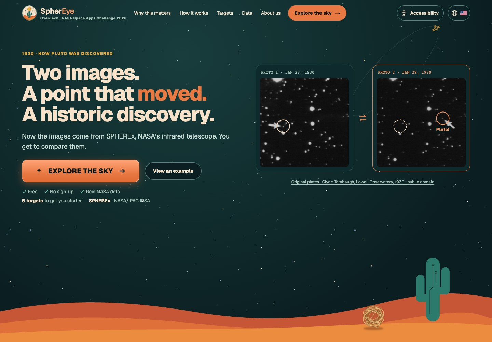
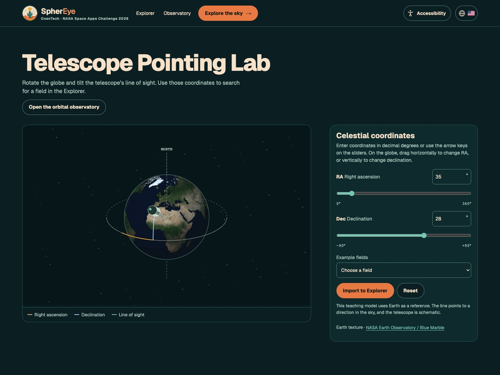
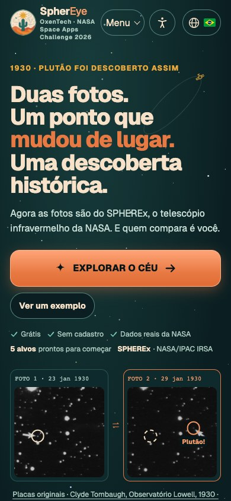

# SPHEREye

SPHEREye is an educational app built by **OxenTech** for the 2026 NASA Space Apps Challenge. It starts with the photographs that led to the discovery of Pluto and asks the same question about images from the SPHEREx infrared telescope: what changed in the sky between two observations?

[**Open SPHEREye**](https://sphereye.earth/) · [**Visit the Portuguese site**](https://sphereye.earth/pt/) · [Planet X and SPHEREx challenge](https://www.spaceappschallenge.org/2026/challenges/planet-x-and-spherex/?tab=details)



## Try it in three steps

1. The [Explorer](https://sphereye.earth/explore/) opens on **M51**, the Whirlpool Galaxy. Select two epochs and switch between them. Use the zoom and target marker to inspect the same area in both images. Saved examples include background information and fun facts about each target.
2. In the [Orbital Observatory](https://sphereye.earth/observatory/), adjust right ascension and declination, then control the simulation time. When you find a target, its details and fun facts open automatically. Revisit the details from the logbook or import the coordinates into the Explorer.
3. In the [Telescope Pointing Lab](https://sphereye.earth/lab/), drag the globe or edit the RA and Dec values to see how each coordinate affects the line of sight. Import the selected position to look up observations in the Explorer.

### Image Explorer

Offline presets include M51, M101, the Orion Nebula, and the Andromeda Galaxy. To search for other fields, enter coordinates in decimal degrees and the app will look up SPHEREx observations in IRSA. Depending on the data available, you can compare grayscale images or false-color infrared composites. The discovery assistant helps you gather context about the observed region in a report you can copy.


### Orbital Observatory

The teaching model combines a simulated telescope, time controls in UTC or Modified Julian Date (MJD), and a logbook. When an image is available, the observatory previews the field the telescope is pointing at.


### Telescope Pointing Lab



### Languages and accessibility

The site opens in English. Use the language selector in the header to switch to Portuguese. The **Accessibility** menu offers controls for text size, contrast, and reduced motion. The main interactions support keyboard input, and the image viewers also support touch gestures.



*Screenshots from the production site.*

## Environment links

| Environment | Frontend | API |
| --- | --- | --- |
| Production (`main`) | [sphereye.earth](https://sphereye.earth/) | [Health check](https://api.sphereye.earth/health) · [Swagger](https://api.sphereye.earth/docs) |
| Development (`develop`) | [Vercel preview](https://sphereye-git-develop-igormonts-projects.vercel.app/) | [Health check](https://api.dev.sphereye.earth/health) · [Swagger](https://api.dev.sphereye.earth/docs) |

## Run locally

The frontend requires **Node.js 22+** and npm. You can use the offline presets with only the frontend running.

```bash
cd frontend
npm ci
npm run dev
```

Open [localhost:3000](http://localhost:3000). The local frontend uses the development API proxy by default. To run the full app locally, install **Python 3.12** and **uv**, then start the backend in a separate terminal from the repository root.

```bash
cd backend
uv sync --frozen
uv run uvicorn app.main:app --reload --port 8000
```

To use the local API, restart the frontend with `NEXT_PUBLIC_API_BASE_URL=http://localhost:8000 npm run dev`. The [local interactive API docs](http://localhost:8000/docs) describe the request parameters. Use [`backend/.env.example`](backend/.env.example) as a reference for backend configuration and allow the frontend origin in `CORS_ALLOWED_ORIGINS`.

### Build and test

```bash
# Frontend (run from the repository root)
(cd frontend && npm run build && npm run typecheck)

# Backend (after installing dependencies with uv)
(cd backend && uv run pytest)
```

The static export is written to `frontend/out`. On Vercel, the production build requires `NEXT_PUBLIC_API_BASE_URL=https://api.sphereye.earth`. The `develop` branch connects to the development API through the rewrites in [`vercel.json`](vercel.json).

## Architecture and API

| Path | Responsibility |
| --- | --- |
| [`frontend/`](frontend/) | Next.js App Router, React, and TypeScript. Contains routes, components, translations, and preset images. |
| [`backend/`](backend/) | FastAPI and Python. Queries IRSA, processes FITS cutouts, and renders images for comparison. Caching in S3-compatible storage is optional. |

- `GET /health` reports API status.
- `GET /epochs` lists visits and observations for a given right ascension and declination.
- `GET /image` renders an observation cutout for one detector or as a false-color RGB composite.

See the [backend README](backend/README.md) for example requests and details on configuration, caching, and deployment.

## Data, credits, and licenses

SPHEREx data comes from the [NASA/IPAC Infrared Science Archive](https://irsa.ipac.caltech.edu/Missions/spherex.html). SPHEREx is a joint project of JPL and Caltech funded by NASA. The app labels simulated examples where they appear. The pointing scenes are teaching models.

The [open-source licenses page](https://sphereye.earth/licenses/) lists third-party libraries, fonts, images, and other resources. The [third-party notices](frontend/public/licenses/third-party-notices.txt) are also available in this repository.
