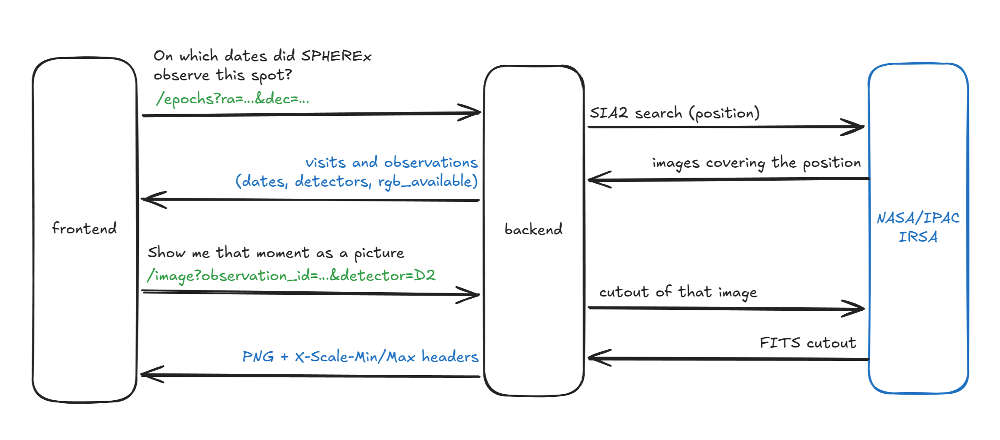

# SPHEREye — API

Routes: `GET /health`, `GET /epochs`, `GET /image` (docs at `/docs`).

Data: NASA/JPL-Caltech/IPAC — SPHEREx, via NASA/IPAC Infrared Science Archive (IRSA)

## How a request flows



1. **Where and when?** `/epochs` lists the visits (moments in time) that cover a sky position. An empty list means SPHEREx has not observed it yet.
2. **Show me.** `/image` renders one observation as a PNG. Reuse `X-Scale-Min`/`X-Scale-Max` on the other dates so brightness stays comparable.

## Run locally

With uv (Python 3.12):

```bash
cp .env.example .env   # optional
uv sync
uv run uvicorn app.main:app --reload --port 8000
```

With Docker:

```bash
docker build -t sphereye-api .
docker run -e PORT=9000 -p 9000:9000 sphereye-api
```

## Examples

```bash
curl http://localhost:8000/health
curl "http://localhost:8000/epochs?ra=210.80227&dec=54.34895&detector=D2"
curl -o m101.png -D - "http://localhost:8000/image?ra=210.80227&dec=54.34895&observation_id=2026W20_2A_0464_3&detector=D2"
# Wide 1 deg field (585 px) enlarged 2x for a big screen (1170 px), small masked holes filled
curl -o m101_2x.png -D - "http://localhost:8000/image?ra=210.80227&dec=54.34895&observation_id=2026W20_2A_0464_3&detector=D2&upscale=2&fill_holes=true"
```

`/epochs` also tells which visits can be rendered in color: each entry of `visits` has
`detectors` (D1..D6 with at least one image in the visit) and `rgb_available` (true when the
visit has D1, D2 and D3, i.e. the default `mode=rgb` works). To build an RGB image, pick a visit
with `rgb_available=true` and pass ANY `observation_id` of it. With the `detector` filter the
visit only sees that detector, so `rgb_available` is always false; omit the filter to check RGB.

More examples (`ra=83.82&dec=-5.39` is the Orion Nebula; take `observation_id` from `/epochs`):

```bash
# Default wide field (1 deg, 585 px)
curl -o wide.png "http://localhost:8000/image?ra=83.82&dec=-5.39&observation_id=<id>&detector=D2"

# Wide field enlarged 2x for a big screen (1170 px)
curl -o wide2x.png "http://localhost:8000/image?ra=83.82&dec=-5.39&observation_id=<id>&detector=D2&upscale=2"

# Default false-color infrared (R=D3, G=D2, B=D1)
curl -o rgb.png -D - "http://localhost:8000/image?ra=83.82&dec=-5.39&observation_id=<id>&mode=rgb"

# "Deep infrared" false color
curl -o rgb_deep.png "http://localhost:8000/image?ra=83.82&dec=-5.39&observation_id=<id>&mode=rgb&detectors=D6,D4,D2"

# Contemplation mode: RGB + stacking + upscale
curl -o best.png -D - "http://localhost:8000/image?ra=83.82&dec=-5.39&observation_id=<id>&mode=rgb&stack=true&size=1.5&upscale=2"

# Reuse the RGB scale across dates (copy the X-Scale-Min / X-Scale-Max values)
curl -o rgb_b.png "http://localhost:8000/image?ra=83.82&dec=-5.39&observation_id=<other_id>&mode=rgb&scale_mins=0.1,0.2,0.3&scale_maxs=5,8,12"
```

## `GET /image` parameters

| Param                                | Type                   | Default                   | Rule                                                                                        |
| ------------------------------------ | ---------------------- | ------------------------- | ------------------------------------------------------------------------------------------- |
| `ra`, `dec`                          | float, degrees         | —                         | required; `0 <= ra < 360`, `-90 <= dec <= 90`                                               |
| `observation_id`                     | string                 | —                         | required, from `/epochs`                                                                    |
| `mode`                               | `single` \| `rgb`      | `single`                  | `rgb`: false-color composite of 3 detectors                                                 |
| `detector`                           | `D1`–`D6`              | —                         | required with `mode=single`; not allowed with `mode=rgb`                                    |
| `detectors`                          | string `Dx,Dy,Dz`      | `D3,D2,D1` (rgb only)     | 3 distinct detectors, R,G,B order, spaces allowed; not allowed with `mode=single`           |
| `collection`                         | enum                   | `IRSA_DEFAULT_COLLECTION` | `spherex_qr3`, `spherex_qr3_deep`, `spherex_dr1`, `spherex_dr1_deep`                        |
| `size`                               | float, degrees         | `1.0`                     | `0.01–3.0`; side of the field of view                                                       |
| `upscale`                            | int                    | `1`                       | `1–4`; final side (`pixels × upscale`) ≤ `MAX_OUTPUT_EDGE_PX`, else `422 REQUEST_TOO_LARGE` |
| `align`                              | bool                   | `true`                    | north-up reprojection at 6.15″/px; must be `true` with `mode=rgb` or `stack=true`           |
| `stack`                              | bool                   | `false`                   | median of the exposures of the same visit (≤ `STACK_MAX_EXPOSURES`); erases moving objects  |
| `fill_holes`                         | bool                   | `false`                   | fill small isolated masked holes (≤ ~40 px) by interpolation                                |
| `subtract_zodi`                      | bool                   | `true`                    |                                                                                             |
| `stretch`                            | enum                   | `asinh`                   | `asinh`, `linear`, `log`, `sqrt`                                                            |
| `colormap`                           | enum                   | `inferno`                 | `gray`, `inferno`, `magma`, `viridis`, `plasma`, `cividis`; ignored with `mode=rgb`         |
| `percentile_low` / `percentile_high` | float                  | `1.0` / `99.5`            | per channel in `mode=rgb`                                                                   |
| `scale_min` / `scale_max`            | float, MJy/sr          | —                         | `mode=single` only; together, `min < max`                                                   |
| `scale_mins` / `scale_maxs`          | string `a,b,c`, MJy/sr | —                         | `mode=rgb` only; 3 numbers each (R,G,B), together, each `min < max`                         |

Invalid combinations return `422 VALIDATION_ERROR`. In `mode=rgb`, a requested detector that
no observation of the reference's visit has returns `404 DETECTOR_NOT_AVAILABLE`
(`details.missing_detectors`, `details.available_detectors`), and a channel without any valid
pixel returns `422 EMPTY_IMAGE` (`details.empty_channels`).

`fill_holes` is an extension of this implementation, not part of
`spec/spec-tool-spherex-image-quality.md`; with the default `false`, every masked or uncovered
pixel stays transparent.

Response headers include `X-Mode`, `X-Image-Width`/`X-Image-Height` (final size,
`pixels × upscale`), `X-Upscale`, `X-Pixel-Scale-Arcsec` (`6.15 / upscale`) and
`X-Native-Pixel-Scale-Arcsec` (always `6.15`). In `mode=rgb`, `X-Detector`,
`X-Wavelength-Min-Um`, `X-Wavelength-Max-Um`, `X-Scale-Min` and `X-Scale-Max` carry 3
comma-separated values (R,G,B) taken from each channel's observation (see below), plus
`X-Channel-Observation-Ids` (the 3 observation ids, R,G,B) and `X-Channel-Time-Span-Seconds`
(earliest `t_min` to latest `t_max` among them). `X-Observation-Id`/`X-Observation-Time` are
always the requested (reference) observation. With `stack=true`:
`X-Stack-Count` (1 value, or 3 in rgb), `X-Stack-Observation-Ids` (ids used, time order),
`X-Stack-Time-Span-Seconds` and, only when the budget cut frames, `X-Stack-Truncated: true`.

### RGB and stacking

`mode=rgb` reprojects three detectors to the same grid and maps them to red, green and blue
(default `D3,D2,D1`: longest wavelength in red). Infrared is invisible to the eye, so this is a
false-color representation.

SPHEREx detectors work in pairs (D1+D4, D2+D5, D3+D6) that see different parts of the field in
each exposure, so one observation covers a given sky position with a single pair, never with
D1, D2 and D3 together. Each channel therefore comes from the observation of the reference's
visit that has that detector and is closest in time to `observation_id` (ties: the older one;
the reference itself when it has the detector). In real data consecutive exposures share the
same pair and the other pairs come back hours or days later (visits group exposures with gaps up
to `VISIT_GAP_DAYS`): at M101, M51 and Orion the channels were 21 h to 4.8 days apart, and some
visits lack a pair entirely (then `404 DETECTOR_NOT_AVAILABLE`; pick an observation of another
visit from `/epochs`). That is fine for the static sky; objects that move or vary between those
exposures may show up with separated colors (`X-Channel-Time-Span-Seconds` gives the interval),
and each channel only covers what its own exposure covered, so the valid area can shrink. `mode=single` is unchanged: the reference
must have `detector`. `stack=true` median-combines the exposures of
the reference observation's visit (background subtracted per frame, then the median background
added back) to reduce noise; it also removes asteroids and other objects that move between
exposures, so keep `stack=false` to look for them.

Before any download, the request is checked against a budget: `total_cutouts` (channels ×
frames) ≤ `MAX_CUTOUTS_PER_REQUEST` and `total_cutouts × fetch_px²` ≤
`MAX_FETCH_PIXELS_PER_REQUEST`. Stacks are reduced first (keeping each channel's observation
and the exposures closest in time to the reference, `X-Stack-Truncated: true`); if even one frame per channel does not
fit, the answer is `422 REQUEST_TOO_LARGE`. Cutouts are downloaded concurrently (at most
`CUTOUT_FETCH_CONCURRENCY` at a time, which also bounds how many raw cutouts are held in
memory). A stack frame that fails to download is skipped; if it is a channel's observation (the
reference in `mode=single`), the request fails with the upstream error.

### Resolution of SPHEREx

Each SPHEREx pixel covers 6.15″ of sky: the telescope was built for all-sky spectroscopy, not
for high-resolution photos (M101, ~28′, spans ~270 px). A larger `size` shows **more sky, not
more detail**; `upscale` only smooths the presentation (Lanczos) and adds no information. No
super-resolution or generative technique is used. The cutout requested from IRSA is
`ceil(size × 1.5 × 3600 / 6.15)` px with `align=true` (`× 1.0` with `align=false`), capped at
2040 px (`size=<n>pix`).

### Memory

A 2040 px cutout holds almost the full detector MEF (~70 MB), hence
`IRSA_MAX_CUTOUT_BYTES=104857600`. RGB composites and stacks with a large `size` use hundreds
of MB of RAM per render. On 512 MB instances use `MAX_CONCURRENT_RENDERS=1` and lower
`MAX_CUTOUTS_PER_REQUEST` / `MAX_FETCH_PIXELS_PER_REQUEST` (and possibly
`CUTOUT_FETCH_CONCURRENCY`); ≥ 2 GiB is recommended.

## Environment variables

See `.env.example`. All are optional.

| Variable                       | Default                                                     | Description                                                                            |
| ------------------------------ | ----------------------------------------------------------- | -------------------------------------------------------------------------------------- |
| `PORT`                         | `8000`                                                      | HTTP port                                                                              |
| `WEB_CONCURRENCY`              | `1`                                                         | Uvicorn workers (container only)                                                       |
| `LOG_LEVEL`                    | `info`                                                      | `debug`, `info`, `warning`, `error`                                                    |
| `CORS_ALLOWED_ORIGINS`         | `http://localhost:3000`                                     | Comma-separated; `*` allowed                                                           |
| `IRSA_SIA_URL`                 | `https://irsa.ipac.caltech.edu/SIA`                         | IRSA SIA endpoint                                                                      |
| `IRSA_ALLOWED_HOST`            | `irsa.ipac.caltech.edu`                                     | Only host cutouts may be fetched from                                                  |
| `IRSA_DEFAULT_COLLECTION`      | `spherex_qr3`                                               | SIA collection                                                                         |
| `IRSA_SIA_MAXREC`              | `5000`                                                      | SIA max records                                                                        |
| `IRSA_SIA_TIMEOUT_SECONDS`     | `30`                                                        | SIA timeout                                                                            |
| `IRSA_CUTOUT_TIMEOUT_SECONDS`  | `60`                                                        | Cutout timeout                                                                         |
| `IRSA_MAX_RETRIES`             | `1`                                                         | Retries on upstream failure                                                            |
| `IRSA_MAX_CUTOUT_BYTES`        | `104857600`                                                 | Max cutout size (100 MB; a 2040 px cutout is ~70 MB)                                   |
| `HTTP_USER_AGENT`              | `sphereye/0.1 (+hackathon)`                                 | Sent on every IRSA call                                                                |
| `MAX_CONCURRENT_RENDERS`       | `4`                                                         | Concurrent renders before `503`                                                        |
| `RENDER_QUEUE_TIMEOUT_SECONDS` | `30`                                                        | Wait for a render slot                                                                 |
| `VISIT_GAP_DAYS`               | `2.0`                                                       | Gap that separates visits                                                              |
| `MAX_OUTPUT_EDGE_PX`           | `4096`                                                      | Max side of the final `/image` PNG (`pixels × upscale`)                                |
| `CUTOUT_FETCH_CONCURRENCY`     | `3`                                                         | Concurrent cutout downloads per request (RGB/stack); also bounds raw cutouts in memory |
| `STACK_MAX_EXPOSURES`          | `8`                                                         | Max exposures in a stack                                                               |
| `MAX_CUTOUTS_PER_REQUEST`      | `12`                                                        | Cutout budget per request (channels × frames)                                          |
| `MAX_FETCH_PIXELS_PER_REQUEST` | `16646400`                                                  | Pixel budget per request (`total_cutouts × fetch_px²`), 4 × 2040²                      |
| `FLAGS_REJECT_NAMES`           | `NONFUNC,MISSING_DATA,HOT,COLD,OVERFLOW,SUR_ERROR,PHANMISS` | FLAGS bits rendered transparent                                                        |
| `APP_VERSION`                  | `0.1.0`                                                     | Shown in `/health` and OpenAPI                                                         |

## FLAGS convention (VAL-008)

Checked on a real `spherex_qr3` cutout (2026-11-14, `2026W20_2A_0464_3` D2): the FLAGS header
does not use `MP_<NAME>` keywords but `MSKN<nnnn> = <NAME>` / `MSKM<nnnn> = 2**nnnn`
(e.g. `MSKN0010 = 'HOT'`, `MSKM0010 = 1024`; `SOURCE` is bit 21). Both conventions are read;
the default `FLAGS_REJECT_NAMES` names all exist.

## Deploy

Build the image and run it on any container platform. The container listens on `$PORT`
(default 8000); set `CORS_ALLOWED_ORIGINS` to the frontend origin and use `GET /health`
as the health check.

```bash
docker build -t sphereye-api .
docker run -e PORT=8080 -p 8080:8080 -e CORS_ALLOWED_ORIGINS=https://your-frontend.example sphereye-api
```

## Cache / Storage

An optional cache keeps rendered PNGs (L2, object storage) and SIA query results (L1 memory and
L2) so repeated requests skip IRSA and the render. It is **off by default** (`CACHE_ENABLED=false`):
then no S3 call is made and `/image` answers with `X-Cache: BYPASS`, as before.

The storage is any S3-compatible bucket. The code is S3-first; in production the provider is
Cloudflare R2 (only the configuration is provider-specific, see the checklist below).

Image credit (keep it wherever the PNGs are published): **Data: NASA/JPL-Caltech/IPAC — SPHEREx, via IRSA**.

### Normalization and cache keys

- `/image` and `/epochs` **always** normalize `ra`/`dec` to the native pixel grid (one SPHEREx pixel,
  6.15″), even with the cache off. The image is rendered from the normalized values, so the picture
  matches its key. `/epochs` `query.ra`/`query.dec` show the normalized values too.
- Keys are `images/{RENDER_VERSION}/{collection}/{observation_id}/{hash}.png` (sidecar `{hash}.json`)
  and `sia/{collection}/{hash}.json`, all under `S3_KEY_PREFIX`.
- 360° is not a multiple of 6.15″, so `ra` is wrapped with `mod 360` before rounding and the point just below 360° maps to `0.0` (e.g. `ra=359.9999` → `0.0`); normalization is idempotent.

### Variables

Set them in the environment (or `.env`, see `.env.example`). "Required" applies only when
`CACHE_ENABLED=true`. Secrets are never logged and never echoed in startup errors.

| Variable                       | Required | Default   | Description                                                                 |
| ------------------------------ | -------- | --------- | --------------------------------------------------------------------------- |
| `CACHE_ENABLED`                | —        | `false`   | Turns the cache on. With `false` no `S3_*` variable is needed.              |
| `S3_ENDPOINT_URL`              | yes      | —         | S3 API endpoint (R2: `https://<ACCOUNT_ID>.r2.cloudflarestorage.com`).      |
| `S3_REGION`                    | —        | `auto`    | R2: `auto`. AWS: the bucket region.                                         |
| `S3_BUCKET`                    | yes      | —         | Bucket name.                                                                |
| `S3_ACCESS_KEY_ID`             | yes      | —         | Access key id of a token limited to this bucket.                            |
| `S3_SECRET_ACCESS_KEY`         | yes      | —         | Secret key (`SecretStr`).                                                   |
| `S3_ADDRESSING_STYLE`          | —        | `path`    | `path` or `virtual`.                                                        |
| `S3_CHECKSUM_MODE`             | —        | `when_required` | botocore `request_checksum_calculation` and `response_checksum_validation`: `when_required` or `when_supported`. |
| `S3_CONNECT_TIMEOUT_SECONDS`   | —        | `5`       | Connect timeout.                                                            |
| `S3_READ_TIMEOUT_SECONDS`      | —        | `20`      | Read timeout.                                                               |
| `S3_MAX_ATTEMPTS`              | —        | `3`       | botocore retries in `standard` mode. Total attempts = `total_max_attempts` = 4. |
| `S3_MAX_POOL_CONNECTIONS`      | —        | `20`      | HTTP connection pool size.                                                  |
| `S3_PUBLIC_BASE_URL`           | yes      | —         | Public URL of the bucket, e.g. `https://pub-<id>.r2.dev`. https, no query string, no trailing `/`. |
| `S3_KEY_PREFIX`                | —        | `""`      | Separates environments in one bucket, e.g. `dev/`. If not empty it must end with `/`. |
| `API_PUBLIC_BASE_URL`          | yes      | —         | Public URL of this API, e.g. `https://sphereye-api.onrender.com`. Used by `json`/`redirect` when the cache is bypassed. |
| `POSITION_QUANTUM_ARCSEC`      | —        | `6.15`    | Position grid. Changing it changes keys.                                    |
| `SIA_CACHE_TTL_SECONDS`        | —        | `21600`   | TTL of SIA results (6 h).                                                   |
| `IMAGE_META_L1_TTL_SECONDS`    | —        | `3600`    | TTL of sidecars in the L1 memory cache.                                     |
| `MEMORY_CACHE_MAX_ITEMS`       | —        | `512`     | Max items of the L1 LRU.                                                    |
| `STORAGE_CIRCUIT_OPEN_SECONDS` | —        | `60`      | How long the circuit breaker stays open after 3 consecutive storage failures. |

The app fails at boot, listing only the **names** of missing variables, when `CACHE_ENABLED=true`
and a required one is missing, or when `S3_KEY_PREFIX` / `S3_PUBLIC_BASE_URL` are malformed.

### Provisioning checklist (Cloudflare R2)

Manual, outside the code (no bucket operation is done at runtime; the token only needs object
permissions):

1. Create the bucket (e.g. `sphereye-images`), automatic location.
2. Create an R2 API Token with **Object Read & Write** permission, scoped to **only** this bucket.
   Save the `Access Key ID`, the `Secret Access Key` (shown once) and the S3 endpoint.
3. In *Settings → Public Development URL*, click *Enable* and confirm. Copy the URL
   (`https://pub-<id>.r2.dev`) into `S3_PUBLIC_BASE_URL`.
4. Do not configure a custom domain (not available in this project).
5. In *Settings → CORS Policy*, set:

   ```json
   [
     {
       "AllowedOrigins": ["*"],
       "AllowedMethods": ["GET", "HEAD"],
       "AllowedHeaders": ["*"],
       "ExposeHeaders": ["Content-Length", "Content-Type", "ETag"],
       "MaxAgeSeconds": 86400
     }
   ]
   ```

   `"*"` is used because all content is public and Vercel previews get a new URL on every deploy.
   To restrict it, replace it with `["http://localhost:3000", "https://<project>.vercel.app"]`.
6. In *Settings → Object lifecycle rules*, delete objects with prefix `sia/` (or
   `{S3_KEY_PREFIX}sia/`) after 7 days. The code already applies the 6 h TTL itself.
7. Check it: `curl -I https://pub-<id>.r2.dev/<test-key>.png` should return `200`,
   `content-type: image/png` and a `cache-control` with `immutable`. Repeat with
   `-H "Origin: http://localhost:3000"` and check `access-control-allow-origin`.
   Result of this check: _to be recorded here after the live run (VAL-503)._
8. On Render, set the variables above and `CACHE_ENABLED=true`.

### Response format (`response_format` on `GET /image`)

| Value               | Hit                                                   | Miss                                                    | Bypass                                         |
| ------------------- | ----------------------------------------------------- | ------------------------------------------------------- | ---------------------------------------------- |
| `png` (default)     | `200 image/png` from storage, `X-Cache: HIT`          | `200 image/png` rendered, `X-Cache: MISS`, upload runs in background | `200 image/png`, `X-Cache: BYPASS`             |
| `json`              | `200 application/json`, `cache_status: "hit"`         | rendered and stored first, then `200`, `cache_status: "miss"` | `200`, `cache_status: "bypass"`, `url` = API URL |
| `redirect`          | `302 Location: <public URL>` + `X-*` headers          | rendered and stored first, then `302`                   | `302` to the API URL                           |

- `json` is the recommended mode for the frontend: one call returns the public URL and all metadata
  (scale, observation, stack). Its body is the sidecar contents plus `url` and `cache_status`.
- `redirect` is for `` straight to the API. Browsers and `fetch` follow the 302 and
  **do not expose** the `X-*` headers of the redirect response, so use `json` when you need the
  scale. The 302 carries `Cache-Control: public, max-age=86400`.
- With the cache off, `response_format=redirect` answers `302` straight to the API URL
  (`{API_PUBLIC_BASE_URL}/image?...&response_format=png`) **without rendering**. Render errors
  (for example `404 DETECTOR_NOT_AVAILABLE`) therefore show up only when that URL is loaded.
- `X-Cache`, `X-Center-Ra`/`X-Center-Dec` (normalized, 6 decimals) and `X-Render-Version` are
  added to the headers. Hits rebuild the other `X-*` headers from the sidecar.

### Frontend usage

```ts
// Recommended: one call, public URL + metadata
const res = await fetch(`${API}/image?ra=${ra}&dec=${dec}&observation_id=${id}&detector=D2&response_format=json`);
const meta = await res.json();
img.crossOrigin = "anonymous";
img.onerror = () => {             // fallback if r2.dev answers 429
  img.onerror = null;
  img.src = `${API}/image?ra=${ra}&dec=${dec}&observation_id=${id}&detector=D2&response_format=png`;
};
img.src = meta.url;               // served by the public bucket URL
const [scaleMin] = meta.scale.min; // reuse on the other dates
const [scaleMax] = meta.scale.max;
```

```html
<!-- Shortcut without metadata -->
/image?ra=83.82&dec=-5.39&observation_id=<id>&mode=rgb&response_format=redirect" />
```

Use `crossOrigin="anonymous"` on every `` that points to the public URL, so the browser cache
never keeps a copy without CORS headers (needed if a `<canvas>` reads the pixels).

### Rendering changes: `RENDER_VERSION`

`RENDER_VERSION` is a constant in `app/processing/__init__.py` (currently `"r1"`). It is part of
every image key. **If a change alters any output pixel** (stretch, mask, reprojection, stack,
upscale, colormap, defaults), **increment it**. Old objects stay in the bucket under the old
version and are never served again. SIA keys do not include it, so SIA results survive the change.

### Deleting cached items

Always delete the **sidecar `.json` before the PNG**. The sidecar is the "write finished" marker:
if the PNG is removed first, the sidecar still exists, `json`/`redirect` return a URL that answers
`404`, and nothing rebuilds it. With the sidecar gone first, the next request is a miss, renders
again and rewrites both objects.

```bash
# Export the token and endpoint of the bucket (any S3 client works; AWS CLI shown here)
export AWS_ACCESS_KEY_ID=<S3_ACCESS_KEY_ID> AWS_SECRET_ACCESS_KEY=<S3_SECRET_ACCESS_KEY> AWS_DEFAULT_REGION=auto
# 1. sidecar first
aws s3api delete-object --endpoint-url "$S3_ENDPOINT_URL" --bucket "$S3_BUCKET" \
  --key "<S3_KEY_PREFIX>images/r1/spherex_qr3/<observation_id>/<hash>.json"
# 2. then the PNG
aws s3api delete-object --endpoint-url "$S3_ENDPOINT_URL" --bucket "$S3_BUCKET" \
  --key "<S3_KEY_PREFIX>images/r1/spherex_qr3/<observation_id>/<hash>.png"
```

`sia/` objects (`{S3_KEY_PREFIX}sia/...json`) can be deleted at any time.

### Degradation and circuit breaker

- Storage errors (network, 5xx, bad credentials) on read or write never fail the request: the
  request is served as `BYPASS` and logged as `error` with `event="storage_unavailable"`.
- After 3 consecutive failures the circuit opens for `STORAGE_CIRCUIT_OPEN_SECONDS` (60 s) and the
  storage is not called at all. `GET /health` reports `cache.enabled` and `cache.circuit_open`
  without touching the storage.
- If IRSA fails and an expired SIA entry exists in storage, that entry is served (stale-if-error),
  logged as `warning` with `event="sia_stale_served"`.
- A request that ends in an error can leave an object under `sia/`, never under `images/`: errors
  (`404`, `422`, `502`, `504`, `EMPTY_IMAGE`, `REQUEST_TOO_LARGE`) are not cached, and the PNG is
  written only after a successful render.
- Storage writes are idempotent (same key, same content). A `429`/`SlowDown` on upload is
  treated as success when a follow-up `HeadObject` confirms the object exists.

## Tests

```bash
uv run pytest                 # offline tests (live tests are skipped)
uv run pytest -m live         # hits the real IRSA
uv run ruff check . && uv run ruff format --check .
```
